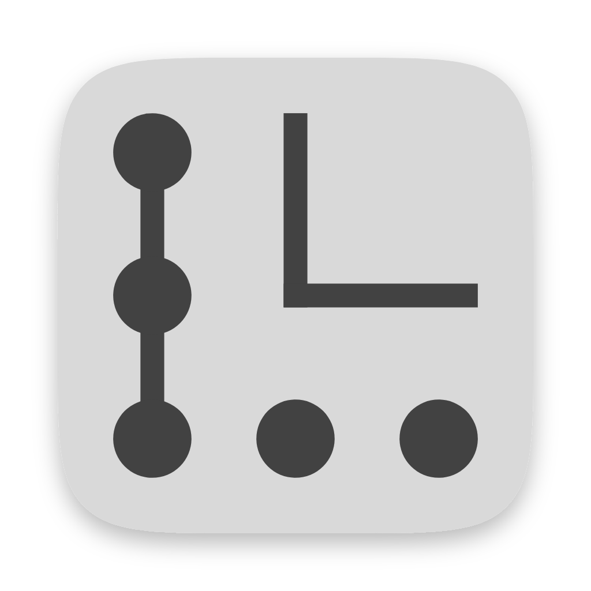

# Lithograph

A portable, offline code editor for C and C++ — charcoal, borderless, Metro-style, built for reading and understanding code as much as writing it.

Copyright (c) 2026 Jatin Aggarwal. All rights reserved except as granted in [LICENSE](LICENSE).

## Status

**Version 1.0** for macOS (Apple silicon), Windows (x64) and Linux (x64): portable apps, downloadable from the repository's [Releases](https://github.com/jay-core/lithograph-editor/releases) page. Each build is checked by opening the packaged app on its own system before it is published. The full design is in [docs/ARCHITECTURE.md](docs/ARCHITECTURE.md). Concept images and animations are in [`docs/concepts/`](docs/concepts/).

Working now:
- **Portable and offline:** a `data/` folder beside the app holds `settings.toml` (live reload) and the session. Saves are atomic, and unsaved edits survive crashes.
- **C/C++ editing with the inbuilt clangd:**
  - errors, completion, hover, ⌘/Ctrl-click to definition
  - rename (F2), fixes and refactorings (⌘/Ctrl .), references (⇧F12)
  - format document (⇧⌥F), and a `.clang-format` editor with a live preview
- **Other languages:**
  - syntax colouring for Rust, Python, Go, CMake, JSON, YAML and Markdown
  - full language engines for Rust (rust-analyzer), Python (Pyright) and Go (gopls), from language packs or the system
- **Preview panes:**
  - calls of the function under the cursor as cards, two levels, shiftable
  - thin colour-square columns with tooltips, pinned highlights, and connectors that follow cards off screen
  - standard-library cards; macros, `static_assert`, lambdas and indirect calls listed after a divider
- **Flow view:** a box-and-arrow overview from every `main`.
  - execution-order numbers, loops, threads, unreached files
  - labels kept off boxes, grouping by folder, boxes you drag stay pinned
- **Memory view:** finds built programs and shows RAM and storage (ELF, Mach-O, PE).
  - budgets and stack usage
  - hover for source details; click to go to the exact line
- **Run with checks:** AddressSanitizer, ThreadSanitizer and UBSan reports linked to the source, plus a profiler that shades lines by how often they ran. It builds outside the project.
- **Compiler window and language packs:**
  - choose the clangd in use
  - install, update or remove LLVM / llvm-mingw, Rust, rust-analyzer, Python, Pyright and Go
  - install the offline C++ reference from a file (⇧F1 opens a page)
- **Tools:** new project from a template, a to-do list from comments, spell-check in comments and strings (system checker), local problem reports.
- **Help and access:**
  - help pages (F1 for what is under the pointer) and a first-run tour
  - the interface in eight languages
  - keyboard focus rings and screen-reader labels
  - high contrast, interface scale, reduced motion, battery saver, touch and pen
- **Terminal** that follows the opened folder, with packs first on `PATH` in Lithograph's terminals only. Also an *options* menu, the macOS menu bar, and closable tabs.

Not built yet:
- Windows and Linux builds (and testing there); an Intel Mac build
- a real end-to-end install of the full LLVM toolchain
- build view, terminal command blocks and splits
- project-wide find and replace, split view, file compare, keymap presets
- assembly view; atlas, book mode and investigation board
- git
- compliance packs (set aside for now)

Not planned: a debugger. Lithograph is a hobby project, and run-with-checks plus the profiler cover finding faults.

## Using the release

Download the file for your system from [Releases](https://github.com/jay-core/lithograph-editor/releases):

| System | File | Download |
|---|---|---|
| macOS 13+, Apple silicon | `Lithograph-1.0.0-mac-arm64.zip` | 224 MB |
| Windows 10/11, x64 | `Lithograph-1.0.0-win-x64.zip` | 191 MB |
| Linux x64 (built on Ubuntu 22.04; needs a distribution of that age or newer) | `Lithograph-1.0.0-linux-x64.tar.gz` | 244 MB |

Unpack it and move the folder wherever you like: a projects folder, or a USB drive. Nothing is installed anywhere else. Lithograph creates `data/` (settings, session, logs) and `language_packs/` beside the app on first run, and sends nothing over the network. Unpacked, the macOS app is 630 MB, most of it Electron plus the inbuilt clangd.

- **macOS**: open `Lithograph.app`. While macOS still has the folder quarantined, don't run it from Downloads; it would run as a read-only copy. For the C/C++ standard headers, install the Xcode Command Line Tools (`xcode-select --install`).
- **Windows**: open `Lithograph.exe`. For the C/C++ standard headers, install the llvm-mingw pack from the compiler window, or use Visual Studio's.
- **Linux**: run `./lithograph` from the folder. If it stops at once with a message about the "SUID sandbox helper" (Ubuntu 24.04 and later restrict Chromium's sandbox), give the helper its rights once with `sudo chown root:root chrome-sandbox && sudo chmod 4755 chrome-sandbox`, or start it with `./lithograph --no-sandbox`. For the C/C++ standard headers, install your distribution's development packages (for example `build-essential`).

On first launch, see *First launch* below.

## Building a release

```
npm run fetch-clangd   # once: the inbuilt clangd, checked against its pinned SHA-256
npm run package        # builds, assembles release/Lithograph-<version>-<os>-<arch>/ and packs it
```

`npm run package` builds for the system it runs on. `src/build/package.mjs` renames Electron's own app and adds Lithograph's built files, node-pty's binary and the inbuilt clangd (in `resources/tools/`, or `Contents/Resources/tools/` on macOS):

- **macOS**: the app bundle and its helpers are renamed and signed ad hoc, which is free; zipped.
- **Windows**: `Lithograph.exe` gets its icon and version details from `rcedit` (install it for the build only: `npm install --no-save rcedit@5.0.2`); zipped.
- **Linux**: node-pty has no ready-built Linux binary, so compile it first with `npx electron-rebuild -f -w node-pty`; packed as `.tar.gz`.

The Windows and Linux releases are built by GitHub Actions ([`.github/workflows/release.yml`](.github/workflows/release.yml)) on each system. It runs the tests, packages, then opens the packaged app with `--smoke … --scenario boot` and fails unless the inbuilt clangd, preview cards, go-to-definition, the terminal and the flow view all work (`src/build/check-smoke.mjs`). Pushing a `v…` tag attaches the builds to that tag's release; the macOS zip is built on a Mac and added to the same release. The icon is made from `assets/icon/lithograph-1024.png` (any 1024 × 1024 PNG); `npm run icon` renders it from `assets/icon/lithograph.svg`. Output goes to `release/`, which git ignores.

## Running from source

Needs Node.js 22+.

```
npm install
node node_modules/electron/install.js   # fetches the Electron binary (npm blocks install scripts by default)
npm run fetch-clangd                    # the inbuilt clangd for this platform, checked against its pinned SHA-256
npm start
```

The inbuilt clangd lives in `tools/clangd/` (kept out of git: its binary is larger than GitHub allows). Without it, Lithograph uses the system's clangd.

### Compiler toolchains and language packs

The **compiler** button (bottom left) opens a window to choose the clangd in use and to install, update or remove packs such as the full LLVM toolchain (llvm-mingw on Windows). Packs go into `language_packs/` beside the app — created empty on first run — and nowhere else:

- each pack comes from its project's official releases: GitHub (LLVM, llvm-mingw, clangd, rust-analyzer, Python builds), static.rust-lang.org, go.dev, or the npm registry (Pyright);
- every download is checked against the checksum its source publishes (SHA-256, or npm's SHA-512) and unpacked by Lithograph itself (`.zip`, `.tar.zst`, `.tar.gz`, `.gz`). No installer or script runs, and entries that would land outside the folder are refused. The Go pack then builds gopls with its own `go`; modules are verified by Go's checksum database;
- Cargo's registry, Go's module cache and pip's cache are pointed inside their packs in Lithograph's terminals;
- the C++ reference publishes no checksum, so it installs from an `html-book-….zip` you download yourself;
- an installed toolchain comes first on `PATH` in Lithograph's own terminals only, through start-up files kept in `data/state/shell-init/` that load your usual shell configuration first. Your shell files, system `PATH` and other terminals are never changed;
- the standard C/C++ headers still come from the system (Xcode Command Line Tools on macOS, the distribution's development packages on Linux); on Windows the llvm-mingw pack brings its own.

`npm test` runs the unit and integration tests in `src/tests/`. `npm run smoke` drives the real app against `samples/tinyhttp` (build it first with `samples/tinyhttp/build.sh`) and writes screenshots to `data/logs/`. Add `-- --scenario memory|compiler|fonts|extras` after the folder for one part only.

## What it is

- **Portable** — one folder, no installer; settings and data live in `data/` beside the executable.
- **Offline** — everything works without a network; language packs are the only optional online feature.
- **Previews** — the bodies of every function called from where your cursor is, two levels deep, shiftable further.
- **Flow** — a box-and-arrow overview of how the program runs, numbered in execution order.
- **Memory and checks**: memory budgets, plus sanitizer and profiling runs linked to the source.
- **Planned**: calm views for building, and later compliance work (MISRA, DO-178C, AADL).

## Repository layout

| Path | Contents |
|---|---|
| `src/` | All source code |
| `src/main/` | Electron main process: files, settings, clangd and other language servers, language packs, terminals, memory analysis, checks |
| `src/preload/` | The bridge between the interface and the main process |
| `src/renderer/` | The interface (Solid + CodeMirror): editor, previews, flow, memory, windows, help, translations |
| `src/shared/` | Code used by both sides: settings schema, C++ parsing helpers |
| `src/build/` | Build scripts: main process and preload, the release package, the icon |
| `src/tests/` | Unit and integration tests (vitest) |
| `src/concepts/` | The pages and scripts the concept images were rendered from |
| `assets/fonts/` | ArX F1 (code) and Selawik (interface), each with its licence |
| `assets/icon/` | The app icon: its source drawing and the 1024 px image the platform icons are made from |
| `docs/` | `ARCHITECTURE.md` (the complete design) and `concepts/` (images and videos) |
| `samples/` | Sample C++ projects used by the tests and the smoke run |
| `LICENSE`, `THIRD_PARTY.md` | The Lithograph License, and third-party notices |

Created at run time and kept out of git: `data/` (settings and state), `tools/clangd/` (the inbuilt engine), `language_packs/`, `dist/`, `release/`.

## Licence

The Lithograph License: MIT, plus conditions that take precedence —

- **No selling** Lithograph, or paid products and services based on it. Using it for paid work is fine.
- **Credit**: every distributed copy shows *Based on Lithograph by Jatin Aggarwal* and keeps the licence unchanged; modified versions are marked as modified.
- **Name**: modified versions use a different name.

Lithograph is source-available, not open source. Bundled third-party components keep their own licences.

## First launch (unsigned builds)

Releases are not code-signed, to keep the project free of cost.

- **Windows**: SmartScreen → *More info* → *Run anyway*.
- **macOS**: *System Settings → Privacy & Security → Open Anyway*.
