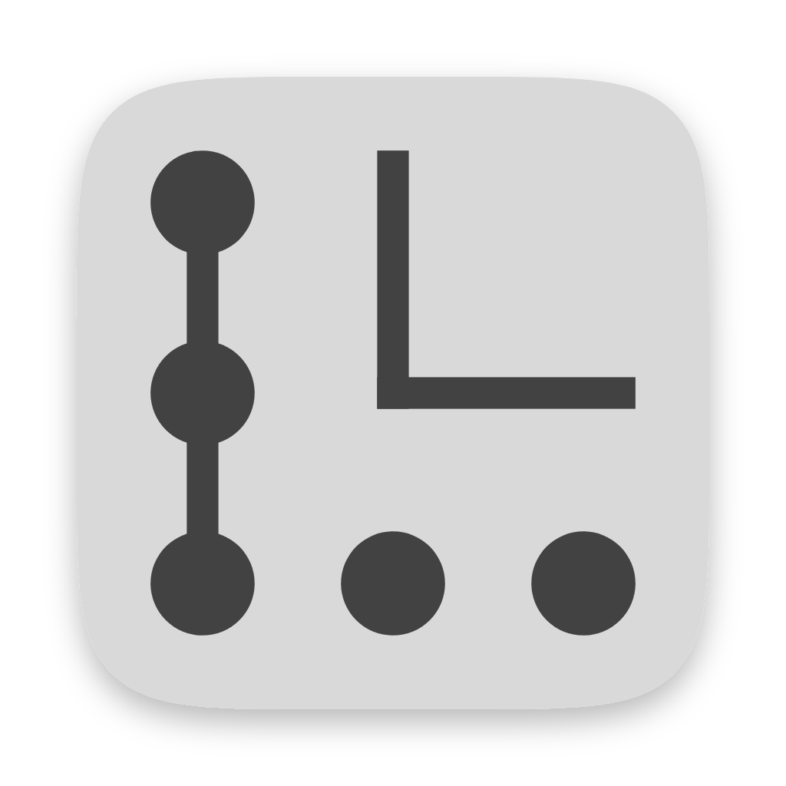

# SkyCodeX 1.2

**The flow views made dependable: the metro and the grid at every size, nothing cut or hidden without a word, and a loading bar that ends only when the flow is ready.**

Built from one commit for macOS, Windows and Linux. 308 of the 392 interface faults listed in [UI-INVENTORY.md](UI-INVENTORY.md) are fixed, 53 are kept by the author's verdict or were not faults, and 31 are open (below).

## New

- **Flow views: metro and grid.** Two ways to read a run: the metro (a sequence of steps down the page) and the grid (functions × steps). The outlined calls in the code preview go to their step; the full card has an up-down divider; run bars have colours, a legend and zoom.
- **The grid at every size.** One view at every size of run, with no switch to a different view on large runs. Only what is in view is built. Sizes and offsets come from measured content, and file and function names are shown in full. Arrows start and end on their step's numbered box. Every case is drawn: entry arrows, every link, and marks for repeats, loops, recursion, threads, folded calls and values. The key explains the dots and marks first.
- **Loading bar.** A dotted arrow in five parts (entry points, index, trace, reading each function, stable) on an aligned dot grid. It ends only when the flow is ready.
- **Folded calls are shown.** A short helper folded into its caller is listed in the step card ("uses … · short helpers folded into this step"), and the entry function's folded helpers are named in the grid's heading. A grid with no squares says what the entry calls instead of standing empty.
- **Settings for the analysis.** `analysis.lock_calls`, `unlock_calls`, `alloc_calls` and `free_calls` add your own functions to the built-in lists of lock, unlock, allocation and free calls.
- **Longer lists.** 30 recent folders (scrolling; the first five open with the number keys). Up to 200 commits to compare with, 40 at a time with "show older". 100 releases of clang and clangd, and 30 each of rust-analyzer and Rust. Search results 3,000 at a time with "show more".
- **Go to definition is the same in every code view:** an underline that shows the destination, ⌥-click to peek, and a reason when there is none.

## Fixed

- **Nothing cut without a word.** Text that is cut can be reached in full on hover, by opening or by scrolling. One-line text has its own bound and no longer runs over its neighbours. Tabs, chips and long lists scroll.
- **Nothing on a timer.** Messages stay until they are read and stack. Overlays close one at a time with Esc and open where they can be seen. Setting and compare menus fit their content and the window.
- **Failures are said.** A function with no syntax tree, a failed analysis and failed ways out or pairs are named in both views' heading, with every reason on hover. Search, file listing, pack and compiler failures say what failed. The flow says when clangd is still settling.
- **Limits are said when they are reached:**
  - search stops at 20,000 matches, searches the first 50,000 files and names the files over 4 MB it skipped;
  - "how they connect" traces the first 20 programs and says how many more were not traced;
  - the flow says how many declarations past the first 2,000 are not used, and when it stops at 20,000 functions or 400 levels;
  - fixes are looked for in the first 12 errors, and the note says so and when the time for checking ran out;
  - the compile database SkyCodeX writes leaves out third_party, third-party and vendor folders and says so, and names any limit it reaches (20,000 sources, 12 folder levels, 400 header folders);
  - compilers that do not answer within 5 s are listed.
- **The grid's frozen footer** sits at the visible bottom, above the run bars; rows scrolled under it no longer show below it.
- **Buttons always visible.** A recent folder's remove button, a tab's close and the window's buttons are always faintly visible, not only on hover.
- **Engine.** A one-line function definition counts as a function for the preview. Two of the colour settings were used by no rule; they are removed.
- **Stability.** The preview keeps its selection while clangd settles; clicks are never lost; clangd restarts by itself; compile database reads are safe and writes atomic. Settling stops once the flow is stable, and calls clangd reported are not left waiting.
- **Less repeated work.** A run is turned into text once and kept, "lines changed" keeps two rows instead of the whole table, and work per move in the metro no longer grows with the whole run.

## Open: for a later release

### Eight items that need a redesign, not a local change

Each item gives what it does now, then every file to read in full before changing it. Line numbers are as of this release.

1. **The flow's fingerprint reads the size and time of every source file each time it is checked.**
   - `src/main/main.ts:442` (`flow:fingerprint`)
   - `src/main/files.ts:76` (`listSourcesAsync`)
   - `src/main/main.ts:157` (the folder watcher, `fs:changedBatch`)
   - `src/renderer/lib/flowstore.ts:73`, `:150`, `:174` (its three callers)
   - `src/main/lsp.ts` (the compile database folder, `ccDir`)
2. **The files pane builds the tree of every open folder, not only the part in view.**
   - `src/renderer/components/FilesPane.tsx:21` (one listing per folder)
   - `src/main/files.ts` (`listDir`)
   - `src/main/main.ts:131` (`fs:list`)
   - the files pane rules in `src/renderer/styles.css`
3. **The metro's depth spine draws every step on each redraw.**
   - `src/renderer/components/Sequence.tsx:624` (`drawSpine`)
   - `src/shared/flowseq.ts:180`, `:184`, `:193` (`layoutSeq`, `placeAt`, `stackSeq`)
   - Note: a strip redrawn under a clip differed by up to 40 of 255 in edge pixels, so no exact partial redraw has been found yet.
4. **The metro's run bars draw every step on each redraw.**
   - `src/renderer/components/Sequence.tsx:1142` (the bars' canvas)
   - the same layout functions as item 3
   - Note: a cached layer with only the hovered and current bars redrawn differed from the old drawing in 851 of 2,592 states.
5. **Changing the detail level walks every step.**
   - `src/shared/flowseq.ts:460` (`codeBlocks`)
   - `src/shared/flowseq.ts:243` (`hiddenBy`)
   - `src/renderer/components/Sequence.tsx:188` (its caller)
6. **The step card builds a row for every call of the function in the run.**
   - `src/renderer/components/StepPreview.tsx:240` (the rows)
   - `src/shared/flowseq.ts:362` (`ownFrames`)
   - `src/shared/metrofacts.ts` (the card's facts)
7. **Every level of preview cards stays built, each card an editor, and is only hidden.**
   - `src/renderer/components/Preview.tsx:56`, `:67` (the levels)
   - `src/renderer/lib/preview.ts:32` (`levels`)
   - `src/renderer/components/Card.tsx`
8. **The magnifier copies the whole view it magnifies, and copies it again on every change.**
   - `src/renderer/components/Magnifier.tsx:14` (`cloneNode`)
   - `src/renderer/components/Magnifier.tsx:36` (the change observer)

### Also open

- **The loading bar's one 83 ms frame:** test P5.B.3 in [TEST-SUITE.md](TEST-SUITE.md). Read `src/renderer/lib/loadbar.ts` and `src/renderer/components/LoadBar.tsx`.
- **`.ph` headings in general:** `src/renderer/styles.css:80`. They don't wrap and have no bound of their own; Programs uses `.ph.fwrap` for its own heading.
- **Limits kept but not yet said when they are reached:**
  - `src/main/compilers.ts:104`: the first 5,000 compile commands are read for compilers;
  - `src/main/compilers.ts:116`: at most 24 compilers;
  - `src/main/files.ts:57`, `:76`: the first 20,000 source files; programs past them are not offered;
  - `src/main/files.ts:63`: the first 50,000 files (said in search only);
  - `src/main/targets.ts:12`: build files 8 folder levels down;
  - `src/shared/flowpairs.ts:114`: 16 rounds when pairing calls;
  - `src/shared/repair.ts:84`, `:116`, `:203`: the first 400 lines, 4,000 characters back, at most 8 fixes;
  - `src/main/main.ts:425`: 3 fixes per error;
  - `src/renderer/lib/goto.ts:95`: a peeked definition's end is looked for in 40 lines;
  - `src/shared/gridlinks.ts:94`: a value is followed back through parameters one level;
  - `src/renderer/lib/flow.ts:311`: "how they connect" goes 400 levels down;
  - `src/renderer/lib/flow.ts:483`: 12 "could be" names for a call through a pointer.
- **The remaining open interface faults:** the inventory's tally gives 31 open. The item-by-item list has not yet been reconciled against every club note: a script comparing fault rows with the notes found 102 rows not named one by one, because many fixes are recorded in bulk. Reconciling them is the first task for 1.3.

## Downloads

| System | File |
|---|---|
| macOS 13+, Apple silicon | `SkyCodeX-1.2.0-mac-arm64.zip` |
| Linux x64 (Ubuntu 22.04+) | `SkyCodeX-1.2.0-linux-x64.tar.gz` |
| Windows 10/11, x64 | `SkyCodeX-1.2.0-win-x64.zip` |

Each build has passed a start-up check on the sample project on its own system: the Linux and Windows builds, with every unit test, in the release workflow (`.github/workflows/release.yml`); the macOS build on an Apple silicon Mac. The app code is the same in all three; the Windows build came a day later, once the tests written on macOS also held on Windows (file modes, path separators, macOS-only cases, the default compiler). The builds are not signed with a paid certificate:
- **macOS:** *System Settings → Privacy & Security → Open Anyway*.
- **Windows:** SmartScreen → *More info → Run anyway*.
- **Linux:** see *Read me first.txt* in the folder.
